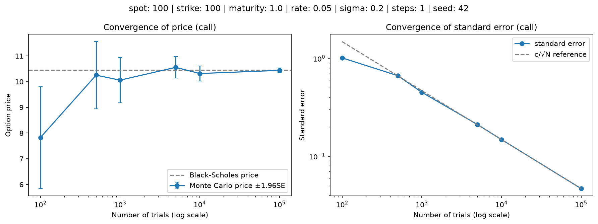
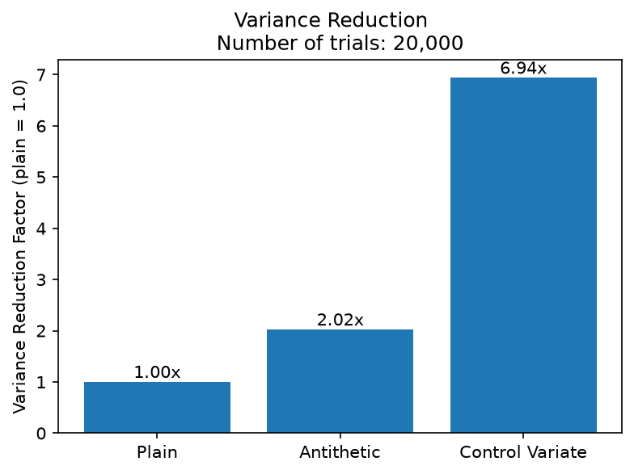
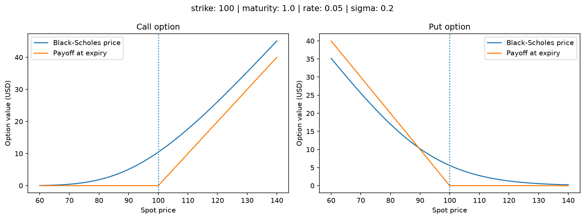
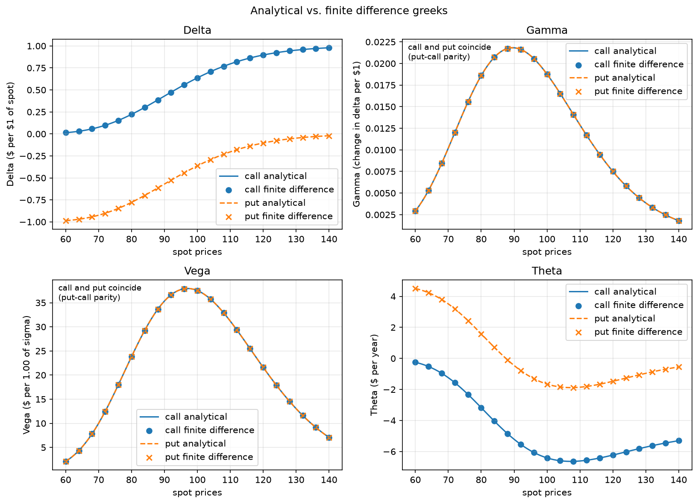
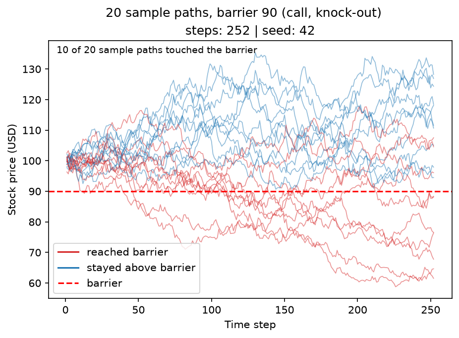
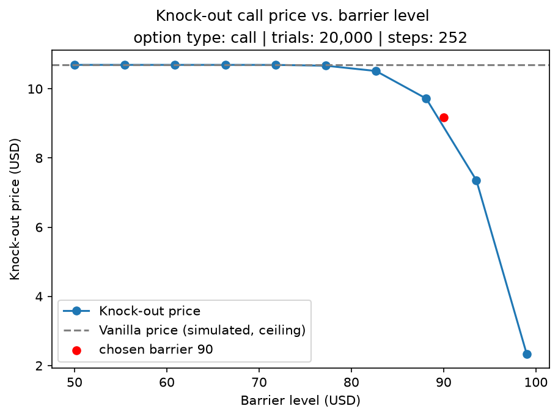
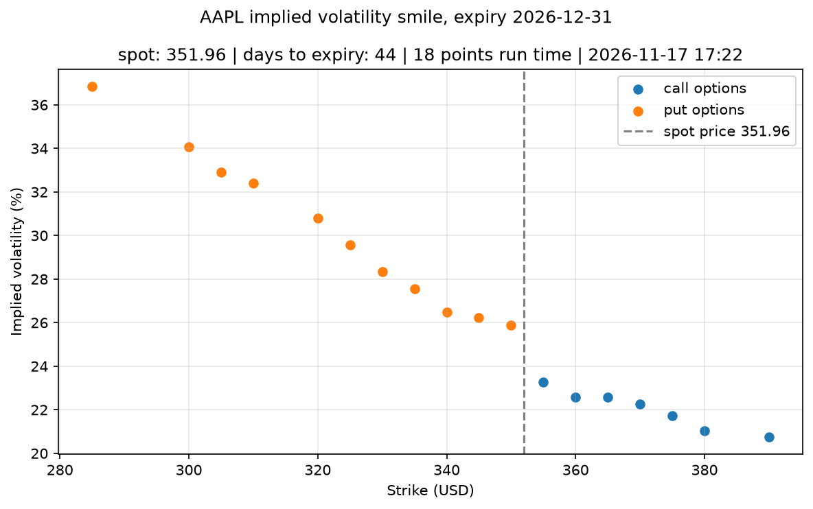

# Option pricing Toolkit: Black-Scholes, Monte Carlo, and the Implied Volatility Smile 

A from-scratch Python implementation of European option pricing, built so that every 
component is checked against an independent method. The toolkit prices options in closed form 
(Black-Scholes) and by Monte Carlo, computes the Greeks analytically and by finite 
differences, inverts market prices into implied volatilities, and extends the Monte Carlo 
engine to Asian and barrier options. A command-line interface runs each part and saves 
diagnostic figures. 

**Validation by cross-checking.** Monte Carlo is checked against Black-Scholes, analytical 
Greeks against finite-difference Greeks, and knock-in plus knock-out against the vanilla 
price. Each check prints a numerical verdict. 

## Contents 

1. [Headline results](#1-headline-results)
2. [Mathematical background](#2-mathematical-background)
3. [Implementation and design decisions](#3-implementation-and-design-decisions)
4. [Results](#4-results)
5. [Usage](#5-usage)
6. [Testing and reproducability](#6-testing-and-reproducability)
7. [Assumptions](#7-assumptions)
8. [Limitations](#8-limitations)
9. [Possible extensions](#9-possible-extensions)
10. [References](#10-references)

---

## 1. Headline results 

Default inputs: spot S = 100, strike K = 100, maturity T = 1 year, rate r = 0.05, annualised 
volatility sigma = 0.20, European call, seed 42. 

| Check | Result |
|---|---|
| Black-Scholes price | 10.4506 |
| Monte Carlo, 20,000 trials | 10.5445 (SE 0.1052), 0.89 SE from Black-Scholes |
| Variance reduction at equal path count | control variate 6.94×, antithetic 2.02× |
| Largest gap between analytical and finite-difference Greeks over a spot grid from 60 to 140 | delta 1.5e-8, gamma 8e-10, vega 2.1e-6, theta 1.1e-4 |
| Knock-in + knock-out - vanilla (same paths) | -1.8e-15 |
| Implied volatility smile | AAPL, 18 liquid out-of-the-money options, about 21% to 37% implied vol | 

---

## 2. Mathematical background 

### 2.1 Model and risk-neutral pricing 

Under the risk-neutral measure Q, the underlying price S follows geometric Brownian motion:

```
dS = r * S * dt + σ * S * dW

S_T = S_0 * exp( (r - σ²/2) * T + σ * √T * Z ),     Z ~ standard normal 
```

Here r is the risk-free rate, σ is the volatility, W is Brownian motion and Z is a standard normal random number. 
The value today of a claim with payoff g is the discounted expected payoff under Q:

```
V_0 = e^(-rT) * E[ g(S) ]
```

Black-Scholes evaluates this expectation in closed form for vanilla payoffs. Monte Carlo 
estimates it by simulation. 

**Exact simulation.** Split [0, T] into n steps of length Δt = T / n. The recursion 

```
S_k = S_(k-1) * exp( (r - σ²/2) * Δt + σ * √Δt * Z_k )
```

gives the correct joint distribution of the price at the grid dates, so there is no
discretisation error. A European payoff needds only the final price, so one step (n = 1) is
enough. Path-dependent payoffs need the whole path, so the exotics use n = 252 steps (daily 
monitoring over one year).

### 2.2 Black-Scholes formula 

```
d1 = ( ln(S/K) + (r - σ²/2) * T ) / ( σ * √T )
d2 = d1 - σ * √T

Call = S * N(d1) - K * e^(-rT) * N(d2)
Put = K * e^(-rT) * N(-d2) - S * N(-d1)
```

N(x) is the standard normal cumulative distribution function and φ(x) is the standard normal 
density. Put-call parity holds for the model prices:

```
Call - Put = S - K * e^(-rT)
```

### 2.3 Greeks (analytical)

The four greeks are derivatives of the option value V:

| Greek | Derivative | Meaning |
|---|---|---|
| Delta | ∂V/∂S | change in value per 1 USD move in the spot | 
| Gamma | ∂²V/∂S² | change in delta per 1 USD move in the spot |
| Vega | ∂V/∂σ | change in value per 1 unit change in sigma |
| Theta | ∂V/∂t | change in value as time passes, = -∂V/∂T | 

The closed forms are: 

```
delta (call) = N(d1)
delta (put) = N(d1) - 1 

gamma = φ(d1) / ( S * σ * √T )
vega = S * φ(d1) * √T

theta (call) = -S * φ(d1) * σ / (2 * √T) - r * K * e^(-rT) * N(d2)
theta (put) = -S * φ(d1) * σ / (2 * √T) + r * K * e^(-rT) * N(-d2)
```

Put-call parity implies that calls and puts share the same gamma and vega, which the figures below confirm. 

**Units.** Vega is per 1.00 change in sigma (divide by 100 for one-volatility-point move).
Theta is per year (divide by 365 for a calendar day, since time decay also runs over 
weeekends). At the default inputs, the call has vega/100 = 0.375 per volatility point and 
theta/365 = -0.0176 per day. 

### 2.4 Greeks by finite differences 

With small bump sizes h_S, h_σ, and h_T, the Greeks can be estimated from the pricing formula alone: 

```
delta ≈ ( V(S + h_S) - V(S - h_S) ) / ( 2 * h_S )

gamma ≈ ( V(S + h_S) - 2 * V(S) + V(S - h_S) ) / h_S²

vega ≈ ( V(σ + h_σ) - V(σ - h_σ) ) / ( 2 * h_σ )

theta ≈( V(T - h_T) - V(T) ) / h_T
```

The first three are central differences, with error proportional to h². Theta is a one-sided
difference, with error proportional to h, so it is the least precise (see agreement table in 
Section 4.3).

### 2.5 Implied Volatility 

The implied volatility of an observed option price is the σ at which Black-Scholes reproduces
that price: 

```
find σ such that black_scholes(σ) = market price 
```

Vega is positive, so the price rises strictly with σ and the solution is unique if it exists.
It exists only if the market price is inside the no-arbitrage bounds:

```
call: max( S - K * e^(-rT), 0 ) < price < S
put: max( K * e^(-rT) - S, 0 ) < price < K * e^(-rT)
```

The slver first checks these bounds. It then runs Newton-Raphson: 

```
σ_new = σ - ( black_scholes(σ) - market price ) / vega(σ)
```

It falls back to bisection on the range 0.01 to 5 if an iterate leaves that range, if vega is 
near zero, or if the iteration does not converge. It stops when the model price is within 
0.0001 of the market price. That tolerance is in **price units**, so the precision in σ is 
roughly 0.0001 / vega, which is worse where vega is small. 

### 2.6 Monte Carlo estimator 

Simulate N independent paths and comput the discounted payoff Y_i = e^(-rT) * payoff_i for each:

```
price estimate = (1/N) * (Y_1 + Y_2 + ... + Y_N)
standard error = s / √N     (s = sample standard deviation of the Y_i)
95% interval = price estimate ± 1.96 * standard error
```

The estimator is unbiased, and the central limit theorem gives an error that shrinks like 1/√N.
In practice, **100× more paths gives 10× less error**, and halving the error costs 4× the paths.
The diagnostic `standard error * √N` should settle near the standard deviation of the discounted
payoff, and it does (Section 4.1).

### 2.7 Variance reduction 

**Antithetic variates.** Each random draw Z is paired with its mirror -Z. with M = N/2 pairs:

```
estiamte = (1/M) * sum over pairs of ( Y(Z) + Y(-Z) ) / 2
variance of estimate = (variance of Y / N) * (1 + ρ)
ρ = correlation between Y(Z) and Y(-Z)
```

for a monotone payoff ρ is negative, so the variance falls. The standard error is computed
across the M pair averages, because the pairs are independent but the two members of the pair
are not. At equal path count, this uses half as many random numbers as plain Monte Carlo.

**Control variate.** Let X = e^(-rT) * S_T be the discounted final price. Under Q, its expected
value is exactly S_0, so its sampling error is known. Use it to correct the payoff:

```
Y_adjusted = Y - β * ( X - S_0 )
best β = Cov(X, Y) / Var(X)
varaince of Y_adjusted = (1 - ρ²) * variance of Y   (ρ = correlation of X and Y)
```

The variance reduction factor is therefore 1 / (1 - ρ²). Here β is estimated from the same 
sample, which adds a bias of order 1/N. The method relies on the simulator preserving 
E[X] = S_0, which the exact exponential step does. 

### 2.8 Exotic options 

Let S_1, ..., S_n be the simulated prices on the monitoring dates (the starting price S_0 is
excluded).

| Call option | Payoff | Quality | 
|---|---|---|
| Asian (arithmetic) | max( A - K, 0 ) | A = (S_1 + ... + S_n) / n |
| Down-and-out | max( S_n - K, 0 ) | if min(S_1..S_n) > H, else 0 | 
| Down-and-in | max( S_n - K, 0 ) | if min(S_1..S_n) ≤ H, else 0 |

The barrier H lies below the spot price, and there is no rebate. Two properties are used as checks:

1. **In-out parity.** On any set of paths, knock-in + knock-out = vanilla exactly, because each
path is exactly one of the two cases. The code tests this to a tolerance of 1e-9, far above
floating-point error and far below any real bug. 
2. **Asian below vanilla.** For a call with r ≥ 0 and no dividends, the Asian call is worth no
more than the vanilla call. This follows from Jensen's inequality, which gives 
max(A - K, 0) ≤ average of max(S_k - K, 0), together with the fact that the expected value of
max(S_t - K, 0) does not decrease with t. The ordering is **not** guarenteed for puts. It holds
at the default inputs, but it is not a general law. 

**Discrete monitoring bias.** The barrier is checked only on the simulation dates, so a path can
cross it between dates unnoticed. The simulated knock-out is therefore slightly too high, and 
the knock-in slightly too low, comparede with continuous monitoring. The Broadie-Glasserman-Kou
correction approximates a discretely monitored down barrier by a continuously monitored barrier at:

```
H_effective = H * exp( -0.5826 * σ * √ΔT )
```

---

## 3. Implementation and design decisions 

| File | Role |
|---|---|
| `black_scholes.py` | Closed-form price; returns (price, d1, d2) so other modules can reuse d1 and d2 |
| `greeks.py` | Analytical and finite-difference Greeks |
| `implied_vol.py` | Newton-Raphson solver with bisection fallback |
| `monte_carlo.py` | Price simulator, European, antithetic and control variate estimators, Asian and barrier payoffs | 
| `market_data.py` | Option-chain download (yfinance), liquidity filter, smile construction |
| `main.py` | Command-line interface, printing and plotting | 
| `make_snapshot.py` | Saves a dated market snapshot to `data/` |
| `tests/`, `pytest.ini` | Test suite (run with `pytest`) |

**Seeded random number generator.** Every simulation takes an explicit `numpy.random.Generator`.
A command creates one generator from `--seed` and passes it through every call, so each 
simulation continues the same stream and every run is reproducible. Re-seeding inside a loop 
would feed identical random numbers to every run, correlate the estimates and flatter the 
convergence plot. A passed-in generator is used instead of `np.random.seed` because that 
function sets hidden global state shared by every random call in the program, whereas an 
explicit generator lets each part of the code control its own randomness and keeps tests from 
interfering with each other. 

**Fair antithetic comparison.** Plain and antithetic estimators use the same number of simulated
paths. The antithetic estimator uses N/2 pairs and N/2 random draws. The `variance` command 
requires an even trial count and raises `ValueError` otherwise, because an odd count would 
silently drop one path. 

**Units.** Vega is per 1.00 of sigma and theta is per year. Divide vega by 100 for
per-volatility-point figure and theta by 365 for a per-calendar-day figure (Section 2.3).

**Input validation.** The pricing functions reject non-positive S, K, T, and σ. The finite-
difference Greeks need S > h_S, σ > h_σ, and T > h_T, because the bumped inputs 
(S - h_S, σ - h_σ, T - h_T) must remain valid. 

---

## 4. Results 

### 4.1 Monte Carlo converges to Black-Scholes at the 1/√N rate 



*Price converges to Black-Scholes, and the standard error falls as 1/√N.*

Call, S = K = 100, T = 1, r = 0.05, sigma = 0.2, one step, seed 42. Black-Scholes price: 10.4506.

| Trials N | MC price | Standard error | Gap (standard errors) | SE × √N |
|---:|---:|---:|---:|---:|
| 100 | 7.8258 | 1.0120 | 2.59 | 10.12 |
| 500 | 10.2523 | 0.6658 | 0.30 | 14.89 |
| 1,000 | 10.0581 | 0.4506 | 0.87 | 14.25 |
| 5,000 | 10.5566 | 0.2111 | 0.50 | 14.93 | 
| 10,000 | 10.3161 | 0.1485 | 0.91 | 14.85 |
| 100,000 | 10.4381 | 0.0468 | 0.27 | 14.81 | 

From N = 1,000 to N = 100,000, (100× the paths) the standard error falls from 0.4506 to 0.0468, a
factor of 9.6 against the theoretical 10. The column `SE × √N` settles near 14.81, the standard
deviation of the discounted payoff. At N = 100, the interval is wide and the normal 
approximation behind it is least reliable. Each trial count uses fresh, independent paths from 
one generator. 

### 4.2 Variance reduction 



*At equal path count, control variate has about 6.9× lower variance than plain Monte Carlo (plain would need about 6.9× the trials), antithetic about 2.0×. Single run, seed 42.*

The control variate's measured correlation with the payoff is 0.925, which predicts a factor of 
1 / (1 - 0.925²) = 6.94, matching the observed factor. An antithetic factor of 2.02 corresponds
to a correlation of about -0.5 between a path and its mirror. 

**Seed robustness.** Across seeds 1 to 20 at this setting, the antithetic factor ranges from 
1.85 to 2.12 and the control-variate factor from 6.64 to 7.04. The ranking never changed. 

| Method | Price | Standard error | Variance reduction | 
|---|---:|---:|---:|
| Plain | 10.5445 | 0.1052 | 1.00 |
| Antithetic | 10.4686 | 0.0740 | 2.02 |
| Control variate | 10.4630 | 0.0399 | 6.94 | 

### 4.3 Greeks: analytical against finite difference 



*Black-Scholes value against the payoff at expiry (strike 100, one year to expiry). The gap is* 
*the option's time value, widest near the strike. The put's value falls below its payoff at low*
*spot prices, because a European put cannot be exercised early and the strike is received only*
*at expiry. At S = 60, the put is worth about 35.1, below its intrinsitc value of 40.*



*The two methods agree across spot 60-140. Theta differs at most (1e-4) because its finite-difference is one-sided and only first-order accurate.* 

At S = 100: 

| Greek | Call (analytical) | Call (finite difference) | Absolute difference | 
|---|---:|---:|---:|
| delta | 0.636831 | 0.636831 | 8.6e-9 |
| gamma | 0.018762 | 0.018762 | 2.7e-10 | 
| vega | 37.524035 | 37.524034 | 3.0e-7 | 
| theta | -6.414028 | -6.414132 | 1.05e-4 | 

Theta has the largest discrepancy, as expected from its first-order difference. 

### 4.4 Exotic options



*Twenty of the 20,000 simulated paths (seed 42, 252 steps). Red paths touched the barrier at 90*
*on at least one monitoring date and would be knocked out.* 

Blue paths stayed above it. Across all 20,000 paths, 51.8% touched the barrier, in line with the discrete-monitoring theory value of 52.5%, within about two standard errors. The theory value comes from the continuous first-passage probability:

```
P(price touches H before T) =
    N( ( ln(H/S_0) - μ*T ) / (σ*√T) )
    + (H/S_0)^(2*μ/σ²) * N( ( ln(H/S_0) + μ*T ) / (σ*√T) )

where μ = r - σ²/2
```

evaluated at the shifted barrier H * exp(-0.5826 * σ * √(T/252)). Without the shift, it is 55.1%.
The gap between 55.1% and 51.8% is the discrete monitoring effect described in Section 2.8. 



*Knock-out call price falls from the vanilla price (10.69) toward zero as the barrier approaches*
*the spot; at the chosen barrier of 90 it is 9.18. Barrier monitored at 252 discrete dates.*

For a call option, K = 100, H = 90, 252 steps, 20,000 trials: 

| Product | Price | 
|---|---:| 
| Vanilla (simulated) | 10.6902 (standard error 0.1059) |
| Arithmetic Asian | 5.8772 | 
| Down-and-out | 9.1754 | 
| Down-and-in | 1.5148 | 
| Knock-out + knock-in - vanilla | -1.8e-15 (pass) |

The Asian call is below the vanilla call, as the Jensen argument in Section 2.8 requires. The 
knock-out price is flat at the vanilla value while the barrier is far below the spot price, 
because few paths reach it, and it falls steeply as the barrier approaches the spot price. 

**A note on the vanilla gap.** On this seed the simulatede vanilla price sits 2.26 standard 
errors above the Black-Scholes price of 10.4506. The final price is sampled exactly, so the 
estimator is unbiased, adn this is an ordinary draw (a two-sided probability of about 2.4%) 
rather than a flaw. Other seeds give gaps of 0.5 to 1.8 standard errors (`--seed 1` to 
`--seed 6`). The default seed is not changed to hide it. 

### 4.5 One step vs. 252 steps 

For a European payoff, the final price is sampled exactly at any step count, so n = 1 and n = 252
must agree. With 100,000 trials and seed 42, one stp gives 10.4205 (standard error 0.0468) and
252 steps gives 10.4829 (standard error 0.0469), against a Black-Scholes price of 10.4506. Both 
agree within sampling error and have the same standard error, but 252 steps costs roughly two 
orders of magnitude more run time. Extra steps are needed only for path-dependent payoffs. 

### 4.6 Implied volatility smile (market data)



*The curve is stitched from out-of-the-money puts (left of spot) and out-of-the-money calls* 
*(right of spot). Implied volatility falls from about 27% at strike 285 to about 21% at strike*
*390. A flat line would be the Black-Scholes prediction for constant volatility, so the*
*downward-sloping skew shows that the constant-volatility assumption does not hold for this*
*market.*

A small step is visible where the put and call halves meet at the spot price. Plain Black-Scholes
treats AAPL options as European and dividend-free, which may contribute. Other candidates are the
interest-rate proxy, the spot price, and the option quotes being captured at slightly different 
moments, and bid-ask noise in the midpoints. The cause has not been isolated here. 

**Data pipeline and filters.** For each option the code computes a midpoint, (bid + ask) / 2, and
solves for its implied volatility with the solver in Section 2.5. Yahoo's own implied-volatility
filed was unreliable in places, so volatilities are recomputed. 

| Filter | Threshold | Reason | 
|---|---|---|
| Option side | calls with strike ≥ S, puts with strike < S | Out-of-the-money options are almost entirely time value, so their price is informative about volatility. In-the-money prices are mostly intrinsitc value and carry little volatility information. They are also more liquid and carry less early exercise value. |
| Strike range | abs(K - S) / S ≤ 25% | Far-away strikes rarely trade and their prices are noisy. |
| Quotes | bid > 0 and ask > 0 | A zero bid means no buyer, so the midpoint is meaningless. |
| Volume | more than 2 contracts today | Removes options that have not traded. |
| Open interest | more than 3 | An initial threshold of 10 removed the put strikes between 300 and 320. Their open interest (4, 7, and 9) was low but not negligible, so the threshold was lowered to 3 instead of dropping that range. |
| Bid-ask spread | (ask - bid) / midpoint < 0.30 | A wide spread makes the midpoint an unreliable price. | 

Other choices: midpoints rather than last-trade prices (last trades can be stale). The spot comes
from `fast_info["lastPrice"]` (the most recent trade; it differed from the alternative yfinance
quote by about 0.03). The expiry is the listed date closest to 45 days out, with at least 14
days, which is far enough that T and vega are healthy and close enough that the model assumptions
still roughly hold. The risk-free rate is the latest 13-week Treasury bill yield (`^IRX`). Time 
to expiry is calendar days divided by 365, assuming expiry at 16:00 in the machine's local time
zone. 

---

## 5. Usage 

```bash
pip install -r requirements.txt
python3 main.py <command> [options]   # python3 main.py <command> --help for details 
```

| Command | What it does | 
|---|---|
| `prices` | Black-Scholes and Monte Carlo with 95% interval and gap in standard errors |
| `convergence` | Monte Carlo at 100 to 100,000 trials against Black-Scholes; saves `convergence.png` |
| `variance` | Plain, antithetic, and control-variate comparison; saves `variance.png` |
| `greeks` | Analytical and finite-difference Greeks on a spot grid; saves two figures | 
| `exotics` | Vanilla, Asian, knock-in and knock-out on shared paths; saves two figures | 
| `market` | Implied volatility smile from live Yahoo Finance data; saves `market_smile.png` | 
| `all` | Everything above (if the market download fails, the other sections still run) | 

| Option | Default | Notes |
|---|---|---|
| `--spot`, `--strike` | 100, 100 | positive |
| `--maturity` | 1.0 | years | 
| `--rate` | 0.05 | decimal, continuously compounded, restricted to 0 to 1 | 
| `--sigma` | 0.2 | annualised, positive | 
| `--option-type` | 'call' | 'call' or 'put' |
| `--trials` | 20,000 | must be even for `variance` | 
| `--steps` | 1 (European), 252 (exotics) | time steps over the option's life | 
| `--seed` | 42 | seeds the random generator |
| `--barrier` | 90 | down barrier, must be above 0 and below spot |
| `--spot-min`, `--spot-max` | 60, 140 | Greeks grid (81 points) |
| `--ticker`, `--target-days`, `--min-days`, `--min-volume`, `--min-open-interest` | 'AAPL', 45, 14, 2, 3 | market data | 
| `--show` | off | also display figures (they are always saved to `images/`) |

Examples: 

```bash 
python3 main.py prices --option-type put --strike 105 ---trials 100000
python3 main.py exotics --barrier 85 --seed 7 
python3 main.py market --ticker MSFT
```

`make_snapshot.py` stores a market snapshot (smile, parameters, raw call and put chains) in `data/`.

---

## 6. Testing and reproducibility 

Run the test suite with `pytest` (configuration in `pytest.ini`). All randomness flows from 
`--seed` through an explicit generator, so every printed number and every figure can be
reproduced exactly. Each command also prints its own consistency check: the Monte Carlo interval
against Black-Scholes, analytical against finite-difference Greeks, predicted against observed
variance reduction, and knock-in plus knock-out against vanilla. 

---

## 7. Assumptions 

**Model.** 
- Constant volatility σ and a constant, continuously compounded interest rate r 
- Lognormally distributed prices
- No dividends
- Frictionless, argibtrage-free markets
- European exercise
- Pricing is under the risk-neutral measure

**Numerical.**
- Time to expiry is in years
- The default step count of 252 approximates daily monitoring over one year 
- Barrier monitoring occurs only on simulation dates. 
- Asian averages use the simulated dates only, excluding the starting price 

**Market data.** 
- Yahoo Finance data is delayed and unofficial 
- Midpoint quotes are treated as fair prices
- One short rate is used for all maturities 

---

## 8. Limitations 

**Model.**
- Constant volatility is contradicted by the smile in Section 4.6. The model can match one strike
at a time through its implied volatility, but it cannot reproduce a whole smile with a single σ.
- AAPL pays dividends and its listed options are American. Plain Black-Scholes ignores both. 
Restricting the smile to out-of-the-money options limits the early-exercise effect but does not
remove it. 
- The rate r comes from the 13-week Treasury bill yield, a quoted yield rather than a 
continuously compounded rate. It is used for every maturity. 

**Numerical.**
- Monte Carlo error decreases only as 1/√N. Results from a single seed carry sampling noise (section 4.4).
- Asian and barrier prices are returned without standard errors. 
- Barrier options are down-barrier only, with no rebate. Monitoring is discrete, which biases 
knock-out prices upward and knock-in prices downward. 
- Antithetic and control-variate methods are implemented for European payoffs only. 
- Finite-difference theta is first-order accurate, and every finite-difference Greek needs bump
sizes small enough to limit truncation error but large enough to avoid rounding error. 
- Implied volatility is solved to a tolerance in price, not in volatility. Precision in σ is 
lower where vega is small, such as far from the money or near expiry. Volatilities outside the 
range 1% to 500% are reported as `NaN`.

**Data.**
- Yahoo data is delayed. The spot price and option quotes are not captured at the same instant,
and a spot error shifts the implied volatility of calls and puts in opposite directions. 
- Time to expiry assumes a 16:00 expiry in the machine's local time zone (US options expire at 
16:00 Eastern).
- The smile covers one expiry and a filtered set of liquid strikes. The volume filter depends on 
the time of day at which the data is downloaded. 

---

## 9. Possible extensions 

- Compare the barrier prices against the closed-form continuous-monitoring formula, and apply the
Broadie-Glasserman-Kou barrier shift to the simulated knock-out. 
- Use the closed-form geometric Asian price as a control variate for the arithmetic Asian option.
- Add a dividend yield, rho, and American exercise (binomial tree or Longstaff-Schwartz).
- Replace constant volatility with local volatility, Heston or SABR, calibrated to the smile. 

---

## 10. References 

- Black, F. and Scholes, M. (1973). The pricing of options and corporate liabilities. *Journal of Political Economy*, 81(3).
- Merton, R. C. (1973). Theory of rational option pricing. *Bell Journal of Economics and Management Science*, 4(1).
- Glasserman, P. (2004). *Monte Carlo Methods in Financial Engineering*. Springer.
- Broadie, M., Glasserman, P. and Kou, S. (1997). A continuity correction for discrete barrier options. *Mathematical Finance*, 7(4).
- Hull, J. C. *Options, Futures, and Other Derivatives*. Pearson.

*Market data is from Yahoo Finance via yfinance. It is delayed and unofficial, and is used for*
*illustration only.*


